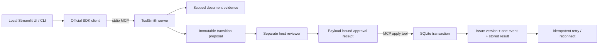

# ToolSmith

A local **Model Context Protocol server** for scoped project-document inspection and reviewable issue transitions. Built with the official Python MCP SDK v2, SQLite and a custom Streamlit client. It exposes ten tools, a policy resource, an issue resource template and a triage prompt template.

The server does not call an LLM. Its purpose is to provide inspectable tools that a compatible host could give to an agent. The verified clients are the official SDK stdio client and the custom UI using that client; no Claude Desktop, Codex or ChatGPT plugin installation is claimed.

## Verified evidence

- **20 unit tests passed**, including a real symlink-scope check on the verification machine, eight concurrent retries producing one event, and transaction rollback after an injected post-update failure.
- **57 protocol/workflow assertions passed** in an actual subprocess stdio scenario with the official SDK client: 40 tool calls, tools/resources/prompts, scope denials, typed-argument rejection, approval, replay and reconnect.
- **Actual UI path passed:** discover tools, search/read source, propose, review through a separate host action, apply and retry. One approved transition produced one event and one version increment.

These counts describe local integration/behavior checks, not model accuracy, a security certification or independent external-host interoperability. See [RESULTS.md](RESULTS.md), [VALIDATION.md](VALIDATION.md) and [benchmarks/mcp-v4.json](benchmarks/mcp-v4.json).



## Tools and scope

| Tool | Behavior |
|---|---|
| `get_policy` | Inspect alpha scope and bounds |
| `list_documents` | Bounded pages with signed, query/snapshot-bound cursors |
| `search_documents` | Lexical AND search; not semantic retrieval or answer generation |
| `read_document` | Relative UTF-8 path, line range, byte-level SHA-256 and untrusted-data label |
| `list_issues` | Alpha-only, bounded keyset pagination and optional status filter |
| `get_issue` | Scoped issue with current version |
| `propose_transition` | Store an immutable proposal; issue state stays unchanged |
| `get_action` | Inspect proposal/status/result without exposing a receipt |
| `apply_transition` | Require a separately approved receipt and matching issue version |
| `list_events` | Latest 20 applied domain events |

Read-only annotations describe domain behavior, not a promise of zero local metadata I/O: SQLite initialization and proposal/review/audit records are persisted. Annotations are hints; application checks enforce scope and workflow regardless of them.

`toolsmith://policy` is a concrete resource. `toolsmith://issues/{issue_id}` is a resource template. `triage_issue` constructs a prompt template; rendering it is not executing an LLM. Approval/rejection methods are **not** MCP tools.

Only `fixtures/alpha/docs` is exposed as a document root. Alpha and beta issue fixtures share the local SQLite file to exercise application scope checks; beta data is not exposed by the tools. All fixtures are fictional, including the excluded beta marker and malicious-text example. Source content is data, never a permission grant.

## Setup — Python 3.11+

```powershell
python -m venv .venv
.\.venv\Scripts\python.exe -m pip install --upgrade pip
.\.venv\Scripts\python.exe -m pip install -r requirements.txt
.\.venv\Scripts\python.exe manage.py init
.\.venv\Scripts\python.exe -m unittest discover -s tests -v
```

`manage.py init` preserves existing state. Runtime SQLite data, receipts, generated configuration and reports belong under ignored `private/` or `reports/`. The exact verified Windows environment is in `requirements-lock-windows.txt` (SDK 2.3.0). No API key, GPU or model download is needed.

## Run the local UI

```powershell
.\.venv\Scripts\python.exe -m streamlit run app.py --server.address 127.0.0.1 --server.port 8522 --browser.gatherUsageStats false
```

Open `http://127.0.0.1:8522`. The UI is a custom client, not the upstream Node MCP Inspector.

1. **Inspect MCP:** connect and discover actual tool schemas, resources, prompts and negotiated protocol.
2. **Documents:** search `retry` and read `retries.md`. Results show source lines and hashes.
3. **Issues & proposals:** inspect `ALPHA-001`. On a fresh fixture it is `todo`, version 1. Propose `in_progress` with the current version and a reason.
4. **Local review:** inspect the exact payload and hash, explicitly check the review box, then approve. The issue is still unchanged.
5. **Apply approved action via MCP:** the first apply changes the issue to version 2. Applying the same action again returns its stored result with `replayed: true`; event history remains one event.

The checkbox is bound to the action/hash, and repeated clicks for an unchanged proposal reuse one idempotency key. The current approval receipt stays in local Streamlit session memory and is not rendered. Losing that session can lose access to the receipt; create/review a new proposal instead of assuming it was applied. Rejection can dismiss stale or expired pending proposals. Changes already made by you persist across restarts, so inspect the current version before proposing another action.

## Actual MCP client from the terminal

```powershell
.\.venv\Scripts\python.exe client.py inspect
.\.venv\Scripts\python.exe client.py search_documents --arguments-file fixtures/requests/search.json
.\.venv\Scripts\python.exe client.py read_document --arguments-file fixtures/requests/read.json
```

The client launches `server.py` as a child and negotiates over stdin/stdout. `server.py` itself has no browser port; running it alone waits for protocol input. Logs use stderr. Every UI read/propose/apply action also uses this real transport, while review deliberately calls the separate local owner function.

For other tools, put the exact published arguments in a JSON file and use `--arguments-file`. `propose_transition` accepts a nested `request` with issue ID, new status, expected version, reason and an 8–64 character idempotency key. Approval CLI: inspect `manage.py pending`, then run `manage.py approve --action-id ... --payload-hash ...` only after reviewing the full payload. The CLI returns a bearer receipt needed by `apply_transition`; do not commit it or paste it into public reports. The UI avoids manual token handling.

## Workflow guarantees and limits

Proposals expire after 600 wall-clock seconds. Before a first application, both approval state and expiry are checked. Allowed transitions are `todo → in_progress`, `in_progress → todo/done`, and `done → in_progress`. Review and application both check expected versions. An accepted apply atomically updates the issue, writes a unique action event, and stores its result in one SQLite transaction using `BEGIN IMMEDIATE`.

A repeated key with the same canonical payload returns the original proposal. A different payload using that key conflicts. A receipt authorizes at most one domain effect; replaying an already applied action may retrieve the stored result even after expiry. Two approved actions for the same old issue version cannot both apply successfully. Rollback was checked with an injected SQLite trigger failure, not an operating-system power-loss test.

Document reads allow only `.md`/`.txt`, reject absolute/parent/device/alternate-stream paths and symlink/reparse-point components, cap files at 64 KiB, output at 80 lines/8,000 characters, and scans at 500 entries. Search reads bounded bytes and rejects a changed snapshot. Document page cursors are HMAC-bound to query, root and source snapshot; changing a file invalidates old cursors. Issue pagination is a bounded keyset view, not an immutable multi-request snapshot.

## Reproduce integration checks

```powershell
.\.venv\Scripts\python.exe -X utf8 verify_mcp.py --output reports/my-mcp-run.json
.\.venv\Scripts\python.exe -X utf8 verify_ui.py
```

The MCP verifier uses a temporary SQLite database, not your interactive demo state. It deliberately injects an expired-action timestamp to test the error path rather than waiting ten minutes. The reconnect scenario discards an already received apply result and reuses its receipt through a new client: a retry-safety test, not an unplanned network outage or automatic recovery service. UI checks likewise isolate only the database path; they do not fake the MCP engine or transport. Integration reports redact receipts and blocked absolute test paths.

## Trust boundary

This is a single-owner local prototype. Application scope checks and out-of-protocol review are not authentication, tenant isolation, cryptographically tamper-proof auditing or an OS sandbox. A local process with access to the project code, SQLite file or reviewer function can bypass or modify the workflow. The root is assumed to be controlled by a trusted owner; hostile concurrent filesystem replacement races are not comprehensively addressed. Approval expiry assumes a trusted local wall clock. Proposal/audit storage has no production retention/rate-limit system.

No shell, arbitrary SQL, document write, email, network-fetch or credential-read tool is offered. No external service is contacted by these tools. The malicious-text fixture tests source-data handling only: with no LLM in the test, it cannot establish prompt-injection immunity. No public HTTP MCP endpoint, OAuth system, production load, Docker deployment, hosted CI result or external chat-host connection is verified. Do not expose this demo as an authenticated multi-user service.

Official references: [Python MCP SDK](https://github.com/modelcontextprotocol/python-sdk), [SDK stdio client transport](https://py.sdk.modelcontextprotocol.io/client/transports/), [tool schemas and annotations](https://py.sdk.modelcontextprotocol.io/servers/tools/). SDK annotations are hints rather than security enforcement; this project tests the application checks separately.
